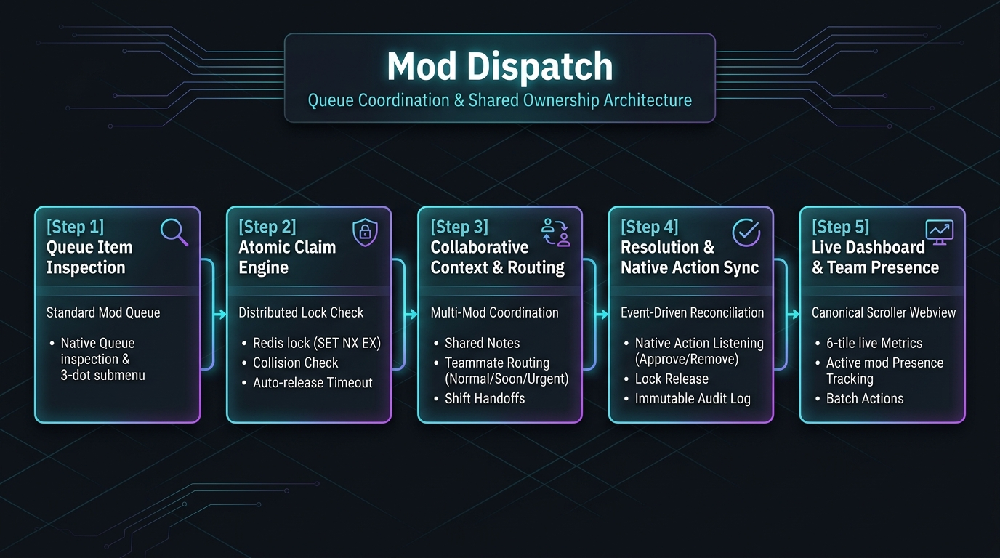

# Mod Dispatch

> **One case. One owner.**

Mod Dispatch adds shared ownership, live coordination, suggestions, and handoffs to the Reddit mod queue—without forcing moderators to leave their normal workflow.

### Key Highlights
- **Atomic Collision Prevention Engine**: Employs distributed Redis locks with configurable timeouts to guarantee that only one moderator reviews or claims an item at any moment, eliminating duplicate reviews.
- **Native Mod Queue Submenu Actions**: Perform claims, suggestions, handoffs, notes, escalations, and resolutions directly from post and comment menus using native Reddit forms.
- **Canonical Scroller v2.1 Status Page**: Default inline webview displays a scannable, non-scrollable queue summary and team presence card that strictly conforms to Reddit launch guidelines.
- **Shift-Resilient Shared Notes & Full Audit Trail**: Context survives moderator shift changes with permanent shared notes, preset flags, and chronological audit histories.

---

## At a Glance

- **In-Queue Coordination**: Moderators claim, suggest, hand off, note, and escalate items right from the native Reddit moderation interface.
- **Race Condition Immunity**: Atomic claim system rejects simultaneous claims with clear messages indicating the active owner and claim time.
- **Dual-Mode Webview Dashboard**: Zero-scroll scannable status page on feed with full expanded view for batch actions, filters, case inspection, and settings.
- **Automatic Mod Action Detection**: Listens for native Reddit actions (approve, remove, spam, ban) via `onModAction`, auto-resolves cases, releases locks, and records outcomes in the audit log.
- **Multi-Item Batch Support**: Select multiple queue items for batch claims, suggestions, handoffs, notes, and escalations with pre-flight collision checks.
- **Zero Unicode Emojis**: Conforms strictly to fleet zero-emoji standard with pure SVG icons and high-contrast badges.
- **Human-in-the-Loop Authority**: The app coordinates and documents decisions; it never removes posts, bans users, or takes unprompted moderation actions.

## How It Works

### The 5-Step Lifecycle

1. **Queue Item Inspection**: A moderator views reported posts or comments in Reddit's standard mod queue.
2. **Atomic Claim Acquisition**: The moderator triggers "Mod Dispatch: Claim for review". Redis evaluates the distributed lock; if free, ownership is assigned with a configurable inactivity timer.
3. **Collaborative Routing & Context**: Moderators attach shared notes, suggest cases to teammates with urgency ratings, or hand off active cases during shift changes.
4. **Resolution or Native Action Detection**: The moderator resolves the case or executes a native Reddit action (approve, remove, spam). Mod Dispatch detects the event, releases the claim, and logs the outcome.
5. **Real-Time Team Oversight**: The non-scrollable status page and expanded dashboard provide live workload visibility, team presence tracking, and a comprehensive audit trail.

---

## Quick Setup (60-Second Onboarding)

1. **Install App**: Install Mod Dispatch on your subreddit via the Reddit Developer Portal.
2. **Open Dashboard**: From your subreddit menu, select **Mod Dispatch: Dashboard** to initialize the pinned control center.
3. **Configure Team Rules**: In the dashboard Settings tab, set your team claim timeout (default: 15 minutes) and designate senior moderators.
4. **Coordinate from the Queue**: Open any post or comment menu in your native Reddit queue to claim, suggest, or add shared notes.

---

## Core Features

### 1. Native Queue Actions & Collision Prevention
- **Claim for Review**: Marks item as actively claimed. Automatically prevents simultaneous claims with informative collision notices ("This item is already claimed by u/example").
- **Release Claim**: Allows the claimant to return an item to the unclaimed queue with optional context (e.g., "Need more context", "Not my area").
- **Inactivity Timeout**: Claims automatically release back to the team after a configurable duration (10, 15, 30, or 60 minutes) if no action is taken.
- **Senior Moderator Overrides**: Senior moderators can safely override stale or stalled claims, with every override recorded in the immutable audit trail.

### 2. Team Routing & Shift Coordination
- **Suggest to Another Mod**: Routes cases to specific teammates with urgency flags (Normal, Needs review soon, Urgent) and contextual notes.
- **Hand Off Ownership**: Transfers active ownership during shift changes, preserving all prior notes, claim history, and audit events.
- **Shared Moderator Notes**: Attach private notes with quick presets ("Needs second opinion", "Waiting on user", "Repeat offender", "Escalate", "Needs rule clarification") or free text. Notes persist permanently.
- **Team Escalation**: Flag complex cases for senior review with standardized escalation categories (safety/legal, rule changes, repeated abuse, appeals).

### 3. Canonical Webview Status Page & Expanded Dashboard
- **Standard Non-Scrollable Status Page**: Strict Canonical Scroller Standard v2.1 compliance. Fits within the visible feed viewport without internal vertical scrolling.
- **Live 6-Tile Queue Summary**: Instant scannability across Unclaimed, Mine, Teammates, Suggested, Escalated, and Resolved items.
- **Team Presence Tracking**: Real-time detection of active moderators and high-level workload indicators (e.g. "u/modA — reviewing 2 items").
- **Expanded Dashboard**: Full tabbed interface featuring queue filtering, search, multi-item batch operations, workload balance, and audit activity streams.

### 4. Multi-Item Batch Operations with Collision Pre-flight
- Select multiple queue items for bulk claim, release, suggest, handoff, note, or escalation.
- Automated pre-flight check detects items already claimed by teammates and skips them with clear conflict reporting, guaranteeing safety across concurrent operations.

### 5. Automated Moderation Detection & External Alerts
- **Native Action Detection (`onModAction`)**: Automatically detects approve, remove, spam, and ban actions taken in Reddit's native interface, closes the corresponding coordination case, releases the lock, and logs the outcome.
- **Discord & Slack Webhooks**: Optional real-time alerts for urgent escalations, queue thresholds, or handoffs.

---

## Designed to Assist Moderators

Mod Dispatch is built as an assistive coordination layer for human moderation teams:
- **Human Authority**: The application never automatically deletes posts, removes comments, or bans users. Final decisions always rest with human moderators.
- **Zero Public Exposure**: Moderator notes, claim states, suggestions, and audit logs are strictly restricted to authenticated subreddit moderators and are never exposed to community members.
- **Zero PII Collection**: Does not collect, sell, or track personal user data. All coordination states are housed within Reddit's native platform Redis infrastructure.

---

## Support

For help, bug reports, or feature requests, post in r/grantdb.
Please include:
- The app name (`moddispatch`).
- What you expected to happen.
- What happened instead.
- Any error message or relevant logs.

---

## Legal

This application is subject to the following legal agreements:
- [Terms of Service](https://github.com/grantdb/reddit-app-legal/blob/main/moddispatch/TERMS.md)
- [Privacy Policy](https://github.com/grantdb/reddit-app-legal/blob/main/moddispatch/PRIVACY.md)

---
*Built for Reddit's moderator community. Part of the GuardHub family.*
