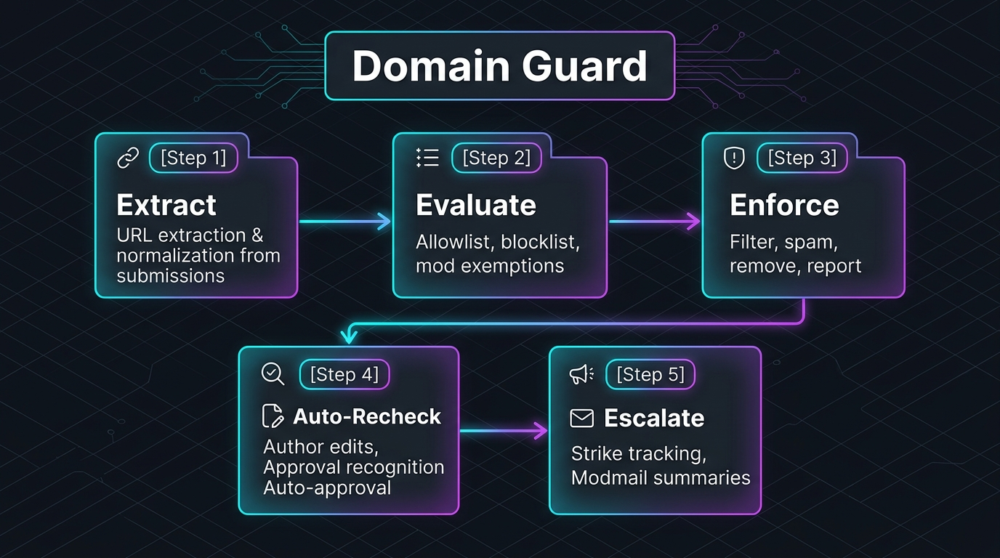

> **User Guide & Overview** | [View Deep Technical Reference & Settings Spec](https://www.reddit.com/r/grantdb/wiki/index/all-apps/piracy-guard)

# Piracy Guard

> **Configurable piracy-content moderation filters for Reddit communities.**

Piracy Guard helps moderators review potentially piracy-related posts and comments using configurable keyword, phrase, regex, and URL-based filters. It is designed to flag likely violations for moderator review rather than automatically remove content.

---

## At a Glance

- **Report-First Default**: Defaults to `report_only` mode, reporting flagged items for moderator review without taking down content or hiding posts.
- **Review-First Architecture**: Does not delete content automatically, ban users, send unprompted public comments, send DMs, or send modmail.
- **Full Devvit Web Dashboard**: Complete 5-tab moderator control center conforming to Canonical Scroller Standard v2.1 with Overview, Preset Rules, Custom Rules, Test Console, and Configuration.
- **Deterministic Rules Engine**: Analyzes submissions across 18 specialized presets spanning Software, Games, Streaming, Shadow Libraries, Credential Dumps, and Sourcing Requests.
- **Operational Safety Suite**: Includes Safe Mode (dry run testing), Panic Disable (emergency disengage), and an automatic Circuit Breaker that pauses enforcement during platform outages.
- **Optimistic Concurrency Control**: Tracks configuration versions (`baseVersion`) and returns HTTP 409 conflicts to prevent concurrent moderator overwrites.
- **Configuration Integrity Checksum**: Generates deterministic 8-character FNV-1a hashes to detect configuration drift and tampering.
- **Rule Health & Tuning Assistance**: Non-destructive rule health metrics (`Healthy`, `Review`, `Noisy`, `Unused`) with false-positive rates to guide filter tuning.
- **Custom Moderator Rules**: Create, edit, duplicate, and delete subreddit-specific filters supporting keyword, literal phrase, regular expression, and domain matching with word-boundary and case-sensitivity controls.
- **Rule Test Console**: Dry-run candidate text against active presets and custom rules directly in Reddit to verify match outcomes before publishing rules, with post and comment simulation modes.
- **Duplicate-Suppressed False-Positive Logging**: Moderators can mark false positives on posts and comments with confirmation and optional 200-character notes without double-counting.
- **Rule Details Inspection**: Dedicated post and comment menu action allows moderators to inspect matched rules, category, confidence, and safe snippets without mutating content.
- **Safe Versioned Configuration**: Full export/import with pre-commit diff summaries and 20-version rollback history. Restoring prior revisions creates new incremented versions rather than destroying history.
- **ReDoS Protected**: Strict heuristic validation rejects dangerous nested regular expression quantifiers (e.g. `(a+)+`) and bounds pattern lengths.
- **Zero PII Telemetry**: Never collects or stores post bodies, usernames, URLs, tokens, or personal identifiers. Daily telemetry is bounded by a strict 30-day retention window.

## How It Works

### The 4-Step Lifecycle

1. **Submission Event Ingestion**: Newly submitted posts and comments trigger non-blocking event handlers (`onPostSubmit`, `onCommentSubmit`) with 24-hour distributed idempotency locking.
2. **Deterministic Rules Evaluation**: The engine normalizes content and evaluates text against 18 deterministic preset filters, custom rules, and domain allowlists.
3. **Operational Safeguards Enforcement**: If the circuit breaker is tripped or Safe Mode is engaged, actions are clamped to log-only; otherwise, high-confidence matches are reported or queued with `keep: true`.
4. **Moderator Review & Feedback**: Submissions appear in the subreddit moderation queue for human determination. False-positive feedback logs deduplicated telemetry to guide ongoing rule tuning.

---

## Enforcement Behavior

Piracy Guard is engineered for moderator oversight and false-positive prevention:

1. **Default Enforcement Mode (`report_only`)**:
   - Newly submitted posts and comments that match enabled rules with confidence meeting or exceeding `minimum_confidence` are flagged via Reddit's native `reddit.report()` API.
   - The reported item appears in the subreddit moderation queue with a clear explanation and the specific matched pattern (e.g. `Piracy Guard: matched rule 'Software — Keygen' (high confidence). Pattern: 'keygen'. Please review.`).
   - The item **remains visible** to the community while awaiting human moderator determination.
2. **Optional Queue Filter Mode (`filter_to_queue`)**:
   - If moderators select `filter_to_queue`, Piracy Guard calls the item's `.filter()` method with `keep: true` to ensure the submission remains accessible in the mod queue.
   - If the runtime environment rejects or does not support the experimental filter call, Piracy Guard automatically falls back to `reddit.report()`.
3. **Diagnostic Logging Mode (`log_only`)**:
   - Submissions matching rules are logged internally with non-sensitive identifiers (rule ID, matched category, confidence level). No action is submitted to Reddit.
4. **Low Confidence Matches**:
   - Low-confidence matches are strictly logged only and never trigger reports or queue filters.
5. **No Automated User Messaging**:
   - Piracy Guard will never send removal comments, modmails, or user DMs.

---

## Production Reliability & Operational Safeguards

Phase 4 hardens Piracy Guard for real subreddit installation with multi-layer defensive mechanisms:

### 1. Circuit Breaker
- **Failure Threshold**: Automatically triggers after 5 consecutive infrastructure failures (e.g. Reddit API timeouts, Redis downtime) within a 60-second sliding window.
- **Cooldown**: Enforcement actions (filter and report) are temporarily paused for 60 seconds, downgrading all evaluation to non-mutating logging.
- **Automatic Recovery**: Decays failure counters and clears cooldown upon successful infrastructure calls.

### 2. Operational Modes
- **Safe Mode (Dry Run Only)**: Evaluates content against active rules and updates dashboard telemetry metrics, but clamps all action recommendations to `log`. Subreddit submissions will never be reported or filtered to the queue while Safe Mode is active.
- **Panic Disable**: Completely disengages content scanning across all post and comment submission events. Returns immediate `none` recommendations with zero Redis writes.
- **Evidence Snippets Opt-In**: Controls whether sanitized 60-character matched text snippets are retained in telemetry logs. When disabled, all snippets are permanently stripped.

### 3. Concurrency Protection & Checksums
- **Optimistic Concurrency**: Every configuration document maintains an incrementing `schemaVersion`. Mutations check the client's `baseVersion` and reject conflicting concurrent updates with HTTP 409 `CONFIG_VERSION_CONFLICT`.
- **FNV-1a Integrity Checksum**: An 8-character hexadecimal checksum is calculated over all active rules, category overrides, and operational flags, enabling immediate visual verification of configuration consistency.

### 4. Telemetry Retention & Data Maintenance
- **Strict 30-Day TTL**: Daily telemetry buckets (`piracy-guard:telemetry:daily:YYYY-MM-DD`) expire automatically after 30 days.
- **Secret Redaction**: Evidence snippets strip URLs (`[url]`), emails (`[email]`), usernames (`[user]`), and API tokens (`[token]`).
- **Data Maintenance Operations**: Moderators can reset aggregate match counters (`/api/clear-telemetry`) or prune historical revision documents (`/api/clear-history`) on demand.

---

## First-Run Onboarding Checklist

When Piracy Guard is installed in a subreddit, the dashboard displays an interactive onboarding checklist:

1. **Enable Piracy Guard**: Verify that scanning is active and Panic Disable is not engaged.
2. **Confirm Enforcement Mode**: Confirm that enforcement is set to `Report Only` (recommended) or `Filter to Mod Queue`.
3. **Set Confidence Threshold**: Ensure the minimum confidence threshold is set to `Medium` (recommended) to minimize false positives.
4. **Review Active Categories**: Review the 6 piracy filter categories and disable any irrelevant to your community.
5. **Test Sample Content**: Use the built-in Test Console to run dry-run evaluations on sample posts and comments.
6. **Review False-Positive Workflow**: Familiarize moderators with the "Mark false positive" menu action to tune local rule health.

---

## Built-In Filter Definitions

Piracy Guard comes equipped with 18 deterministic rule presets categorized into six operational domains:

### 1. Software
- `software_cracked` (Medium Confidence): Matches software described as cracked, nulled, pre-activated, or pirated repacks while avoiding colloquial phrases like "cracked my screen".
- `software_serial_keys` (Medium Confidence): Detects unlicensed product keys, activation keys, and key code sharing. Requires piracy context (e.g. "generator", "crack", "leak", "free", "working", "pastebin") and never matches standalone "serial number".
- `software_keygen` (High Confidence): Identifies software key generators and activation tools.
- `software_license_bypass` (High Confidence): Flags tools and tutorials designed to bypass software activation or reset trial periods.
- `software_grey_market_keys` (Low Confidence, Log Only): Identifies volume license resellers and grey market key marketplaces with low confidence.

### 2. Games
- `games_cracks` (High Confidence): Detects cracked game releases and recognized warez release groups (FitGirl, DODI, Codex, Empress).
- `games_piracy_sites` (High Confidence): Targets prominent warez and cracked game distribution sites (SteamUnlocked, IGG-Games, OceanOfGames, Skidrow).
- `games_drm_bypass` (High Confidence): Identifies Denuvo and DRM bypass utilities.
- `games_console_piracy` (Low Confidence, Log Only, Disabled by Default): Flags console custom firmware (CFW) and emulator ROM sourcing. Disabled by default to prevent false positives on benign emulation discussions.

### 3. Streaming and Media
- `streaming_account_access` (Medium Confidence): Detects shared streaming accounts, unauthorized family plan slots, and account generators.
- `streaming_iptv` (Medium Confidence): Identifies unauthorized IPTV playlists, provider lists, and stalker portals. Requires explicit piracy context and never matches standalone "iptv".
- `media_piracy_terms` (High Confidence): Matches warez media release tags (YIFY, 1337x, RARBG, CAM-Rip), magnet links (`magnet:?xt=urn:btih:`), and torrent downloads. Requires download or link context for "web-dl".

### 4. Ebooks and Courses
- `ebooks_shadow_libraries` (High Confidence): Detects unauthorized links and mentions of shadow libraries (Z-Library, Library Genesis / LibGen, Anna's Archive, Sci-Hub).
- `courses_leaks` (Medium Confidence): Identifies unauthorized distribution and downloads of paid educational courses.

### 5. Accounts and Credentials
- `accounts_credentials` (Medium Confidence): Detects credential combo lists, account dumps, and stolen session token trading. Requires credential context (e.g. "session cookies", "premium cookies", "stealer cookies") and never matches standalone "cookies".
- `accounts_marketplace` (Low Confidence, Log Only): Flags illicit account sales, subscription arbitrage, and lifetime access schemes.

### 6. Requests and Sourcing
- `requests_direct` (Medium Confidence): Flags direct community inquiries asking where to download cracked software, keygens, or links.
- `requests_obfuscation` (Medium Confidence): Detects deliberate obfuscation techniques including `d0wnl0ad`, `cr4ck`, `s3rial`, `k3ygen`, and single-letter spacing.

---

## Support

For help, bug reports, or feature requests, post in r/grantdb.
Please include:
- The app name (`piracy-guard`).
- What you expected to happen.
- What happened instead.
- Any error message or relevant logs.

---

## Legal

This application is subject to the following legal agreements:
- [Terms of Service](https://github.com/grantdb/reddit-app-legal/blob/main/piracy-guard/TERMS.md)
- [Privacy Policy](https://github.com/grantdb/reddit-app-legal/blob/main/piracy-guard/PRIVACY.md)

---
*Built for Reddit's moderator community. Part of the GuardHub family.*
