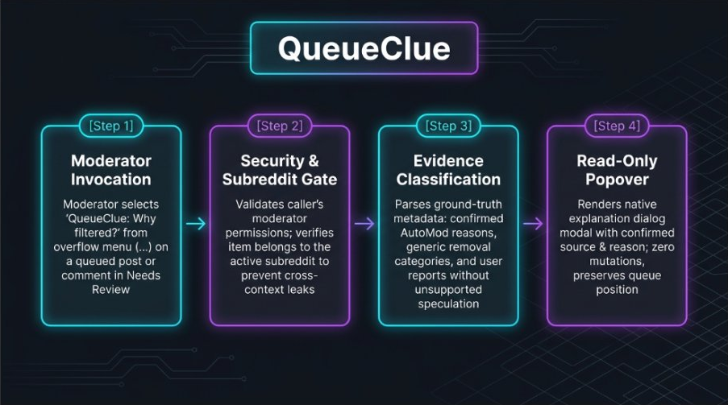

> **User Guide & Overview** | [View Deep Technical Reference & Settings Spec](https://www.reddit.com/r/grantdb/wiki/index/all-apps/queueclue)

# QueueClue

> **Find the available source and reason behind a queue item.**

QueueClue gives moderators a small, clear explanation of why a post or comment was filtered into Reddit's Needs Review queue. Inspect confirmed removal categories, AutoModerator report reasons, and available metadata directly on demand without leaving your queue or changing moderation states.

### Key Highlights
- **Zero-Mutation Safety**: Operates strictly in read-only inspection mode with zero automated approvals, removals, or state mutations.
- **On-Demand Menu Invocation**: Launches instantly from the native item overflow menu on any queued post or comment.
- **Accurate Ground-Truth Attribution**: Distinguishes confirmed filtering sources (such as AutoModerator action reasons) from unconfirmed generic categories and report text.
- **Preserved Queue Context**: Opens a native explanation popover modal so moderators review context and close it without losing their queue position.

---

## How It Works

### The 4-Step Lifecycle

1. **Trigger**: A moderator opens the moderator action menu (shield icon on queue cards, or overflow menu `...`) on a post or comment in the Needs Review queue and clicks **QueueClue: Why filtered?**.
2. **Authorize & Verify**: QueueClue checks the invoking user's active moderator permissions and verifies that the item belongs to the current subreddit before extracting metadata.
3. **Inspect & Classify**: On-demand metadata is evaluated against ground-truth evidence rules (identifying AutoModerator reports, confirmed removal categories, and filtering timestamps without overstating uncertain signals).
4. **Present**: A clean native explanation popover opens displaying the available source, reason, and notes, returning the moderator to their exact queue position upon closing.

---

## Quick Setup (60-Second Onboarding)

1. **Install**: Add **QueueClue** to your subreddit through the Reddit App Directory.
2. **Open Queue**: Navigate to your subreddit's **Needs Review** queue in desktop Reddit Mod Tools.
3. **Inspect Item**: Click the moderator menu (shield icon on queue cards, or overflow menu `...`) on any queued post or comment and select **QueueClue: Why filtered?**.
4. **Review Explanation**: View the available filtering source and reason in the popover modal without modifying item state.

*Zero configuration required. Post and comment explanations are enabled out-of-the-box with sensible defaults.*

---

## Core Capabilities

- **Strict Evidence Standards**: Separates verified filtering sources from generic removal categories (`reddit`) and user reports, ensuring moderators never see misleading explanations.
- **Private Moderator-Only Access**: Enforces server-side permission checks so queue explanation metadata is strictly visible to authorized moderators.
- **Cross-Subreddit Boundary Enforcement**: Prevents cross-context leakage by verifying that targets match the current subreddit before formatting details.
- **Lightweight Event Capture**: Subscribes to real-time AutoModerator filter events to capture exact rule reasons, with zero background cron jobs and volatile 30-day bounded Redis caching.

---

## Designed to Assist Moderators & Privacy

QueueClue is built strictly as a read-only decision aid for human moderation teams. It does not store post or comment content, author usernames, or moderator identities; it temporarily caches limited moderation-event metadata for up to 30 days. Human moderators retain full authority over all queue decisions.

---

## Support

For help, bug reports, or feature requests, post in r/grantdb.  
Please include:
- The app name (`queueclue`).
- What you expected to happen.
- What happened instead.
- Any error message.
- Screenshots or relevant details.

---

## Legal

This application is subject to the following legal agreements:
- [Terms of Service](https://github.com/grantdb/reddit-app-legal/blob/main/queueclue/TERMS.md)
- [Privacy Policy](https://github.com/grantdb/reddit-app-legal/blob/main/queueclue/PRIVACY.md)

---
*Built for Reddit's moderator community.*
